# ledger-desk

[](https://github.com/mattniznik/ledger-desk.mniznik/actions/workflows/ci.yml)

By [Mat Niznik](https://www.linkedin.com/in/matniznik).

The accounts-payable desk of a fictional coffee roastery. Supplier bills arrive as PDFs and phone photos;
Claude reads each one, looks into the ones that do not match and drafts the email to the vendor; plain code
checks every bill against the purchase order, what was delivered, what was already paid and the bank details
on file; and a person approves before anything is booked. Each problem bill comes with the next step a finance
team would take, and every step lands in an audit trail that shows if anyone edits it.

<!-- generated:intro -->
**Live demo: [ledger-desk.mniznik.com](https://ledger-desk.mniznik.com)**, on Microsoft Azure: the app API and the mock ERP
on Azure Container Apps, the database on Azure Database for PostgreSQL, the secrets in Azure Key Vault and the page on
Azure Static Web Apps, all set up with Terraform ([Where it runs](#where-it-runs-microsoft-azure)).

The demo replays 13 recorded real runs of Claude Opus 5.5 through today's code, so it costs
nothing per visit; 13 of 13 end as their answer key says. 392 Python tests and
127 page tests pass, and browser tests check every layout at 1280 x 800 and 390 x 844.

**A customizable page.** 12 layouts, 21 colour sets and 15 typefaces, with the same bills and numbers in all of them; the default is layout 01, Bills up front. See
[Design](#design-the-layouts-on-the-web-and-on-a-phone).

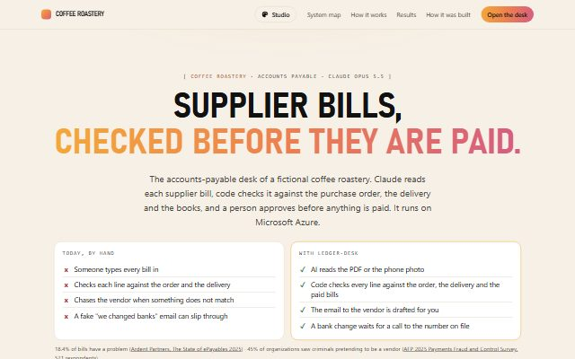
<!-- /generated:intro -->

## Why build it this way

Typing bills in takes time. The bills that do not match need someone to dig, decide and chase the vendor, and
fraud gets through when that checking is rushed. Across the accounts-payable teams Ardent Partners surveyed,
18.4% of bills have a problem and the average bill takes 8.2 days and $9.84 to process; in AFP's 2025 survey of
521 organizations, 45% reported fraud by criminals pretending to be a vendor
([NOTICE](NOTICE) has the sources).

So the work is split. Claude does what a model is good at: reading a document with no template per vendor,
looking things up, explaining what is wrong in plain words and drafting the email. Code does everything that
decides money: the arithmetic, the match against the order and the delivery, duplicates, bank details, who may
approve, and the suggested next step. A person makes every decision, and the approval is a signature the books
verify. A prompt that says "never pay a bill twice" is a request; the duplicate check is the rule.

## How it works

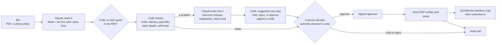

1. **Reading** ([src/ledger_desk/reading.py](src/ledger_desk/reading.py)). Claude returns each field with the
   text it read it from; code checks the quote is in the PDF's text layer. A phone photo has no text layer, so
   its fields are marked for a check by eye.
2. **Checks** ([rules.py](src/ledger_desk/rules.py)). Arithmetic, the vendor, price within 2% of the order,
   quantity against what was delivered and not yet billed, duplicates, a changed bank account, an unusual amount
   for a recurring bill, and text on the bill that reads like an instruction to an AI.
3. **Looking into a problem** ([agent.py](src/ledger_desk/agent.py)). The agent can only read the books and save
   a draft email; it cannot approve, book or pay.
4. **The next step** ([playbook.py](src/ledger_desk/playbook.py)). Worked out by code from what the checks found:
   hold for a corrected bill, reject a copy already paid, hold a bank change until the vendor confirms it on the
   number already on file, approve an overcharge the vendor already credited.
5. **The decision** ([authority.py](src/ledger_desk/authority.py), [approval.py](src/ledger_desk/approval.py)).
   The controller's limit, the phone check for a bank change, a typed reason to override a flag; the approval is
   an Ed25519 signature the ERP verifies.
6. **The run** ([workflow.py](src/ledger_desk/workflow.py)). A LangGraph graph that pauses for the person and
   survives restarts; the database enforces visitor isolation, balanced entries and the audit log
   ([migrations/](migrations/)).

## The eval set

50 bills: the 13 samples and 37 variants (other layouts, more photos, prices just inside and just outside the
2% tolerance), each with its expected result written by hand from the policy, never computed by the rules being
graded; and a hard tier of 10 (blur, skew, low resolution, creases, a two-page bill). Graded by code
([evals.py](src/ledger_desk/evals.py)): every field to the cent, the end result, each flag's precision and
recall, the suggested account, and whether anything reached the books without approval.

## Results

<!-- generated:results -->
One run per configuration, so small differences are unproven. The bills are rendered for the demo and are cleaner
than real scans, so real bills may do worse; that has not been tested.

| Model | Tier | Bills | Ended as expected | Fields read | Accounts | Safe | Cost a bill | Seconds a bill |
|---|---|---|---|---|---|---|---|---|
| Claude Opus 5.5 | standard | 50 | 49 of 50 | 504 of 504 | 21 of 21 | 50 of 50 | $0.0713 | 15.8 |
| Claude Opus 5.5 | hard | 10 | 10 of 10 | 170 of 170 | 4 of 4 | 10 of 10 | $0.0798 | 16.1 |
| Scripted reader (proves the graders, not a model) | standard | 50 | 49 of 50 | 504 of 504 | 21 of 21 | 50 of 50 | none | 0.0 |
| Scripted reader (proves the graders, not a model) | hard | 10 | 10 of 10 | 170 of 170 | 4 of 4 | 10 of 10 | none | 0.0 |

"Safe" means nothing reached the books without an approval. The scripted reader is a perfect reader built from the
answer key: it proves the graders and the checks, not a model.

**The recorded runs the demo replays** (Claude Opus 5.5, effort low): 13 of 13 bills end as their answer
key says; 40 model calls; $0.99 at API list prices in all (mean $0.076, median
$0.082 a bill, n=13); 207.8 s in all (median 18.8 s a bill). They ran on a
Claude Code subscription, so nothing was spent.
<!-- /generated:results -->

### What failed, and what fixed it

- **Amounts with $ and commas.** The first real run read "$2,100.00" on two bills and the reading failed; the
  reader now normalises printed numbers once, with tests on the exact strings.
- **No line numbers on the orders.** Four bills matched no purchase-order line in the first real run; lines are
  now matched by printed number, then by description, and two same-named lines are never guessed.
- **An instruction to the AI transcribed as commentary.** Claude once returned invoice 12's planted footer as its
  own note; the check now reads the printed page first.
- **A paid bill's date shown as a payment date, and an overcharge held when its credit was already waiting.** A
  fresh-context review of the suggested next steps; both fixed test-first ([decision 0007](docs/decisions/0007-next-steps-from-a-code-playbook.md)).
- **Two visitors opening one bill at once.** The browser tests found the PDF being re-rendered while it was
  read; the bill fell out of the queue. Documents are now written only when they change, through an atomic
  replace ([decision 0010](docs/decisions/0010-browser-tests-against-the-real-api.md)).

## Where it runs: Microsoft Azure

| Piece | Azure service |
|---|---|
| The page | Azure Static Web Apps |
| The app API | Azure Container Apps, public ingress, scales to zero |
| The mock ERP | Azure Container Apps, reachable only from the API |
| The database | Azure Database for PostgreSQL, Flexible Server, burstable B1ms, Postgres 17 |
| Secrets | Azure Key Vault, one per app; Terraform reads them at deploy time and gives each app its own |
| Images | GitHub's container registry |

All of it is set up with Terraform (`azurerm`), kept in a private repository so no account or resource ids are
published; [docs/DEPLOY.md](docs/DEPLOY.md) has the steps and [decision 0009](docs/decisions/0009-hosting-on-azure-container-apps.md)
the reasoning. The first deploy found four things that never show on a laptop, each fixed and tested before it went
live:

- **A managed Postgres admin is not a superuser.** On Postgres 17 it cannot switch to roles it created; a migration
  now grants that, after the failure was reproduced in a fresh Postgres 17.
- **A response could reach the client before its commit.** In the API's container on Linux, an approval sent at
  once failed 3 times in 12; every request now commits before it answers.
- **The Container Apps environment refuses Key Vault references** for app secrets, so Terraform reads each secret
  from its vault at deploy time.
- **The subscription allows only some regions**, and the database only in some of those, so the database and the
  apps share one region and the vaults and the page another.

Connection pools are sized to the database tier: 30 of B1ms's 35 user connections.

## Engineering

- [Decision records](docs/decisions/README.md): why each part is the way it is, with the provider docs quoted and
  the measurements.
- [AGENTS.md](AGENTS.md): how work is done here. [SECURITY.md](SECURITY.md): risks, controls, known gaps.
  [docs/DEPLOY.md](docs/DEPLOY.md): how it is hosted on Azure, step by step.

## CI

One workflow, three jobs, no secrets and no model calls: the Python tests on a Postgres service, the page's lint,
types, build and unit tests, and the browser tests at 1280 x 800 and 390 x 844 against the real API in replay
mode.

## Run it yourself

```bash
docker compose up -d db                      # Postgres 17 on 127.0.0.1:55432
uv sync && uv run ledger-desk db-reset       # create and seed the database
uv run ledger-desk api-serve                 # the app API on 127.0.0.1:8200
cd web && npm ci && npm run dev              # the page, proxying /api
```

The bills replay recorded Claude runs through today's code, so nothing calls a model and nothing is spent.

## Limits

- One recorded run per configuration; small differences are unproven. The bills are rendered for the demo and
  are cleaner than real scans.
- The playbook knows the problems the checks name; an unknown one gets "hold and look into it".
- The live demo replays recorded runs; a live model per visitor would need limits and a budget first
  ([SECURITY.md](SECURITY.md)).

## Design: the layouts, on the web and on a phone

<!-- generated:design -->
The default is layout 01, Bills up front, in Golden hour on paper with Barlow Condensed caps + DM Sans.
Each pair is the page at 1280 x 800 and at 390 x 844, with reduced motion so the animations show their last frame.

<table>
<tr><th>Web, 1280 x 800</th><th>Phone, 390 x 844</th></tr>
<tr>
<td></td>
<td>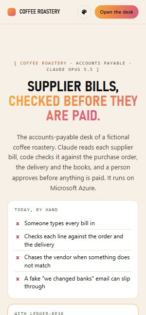</td>
</tr>
<tr><td colspan="2"><b>01 Bills up front</b> (the default) - The bill desk up front with the walkthrough a click away, then a field of dots for every bill the eval read.</td></tr>
<tr>
<td>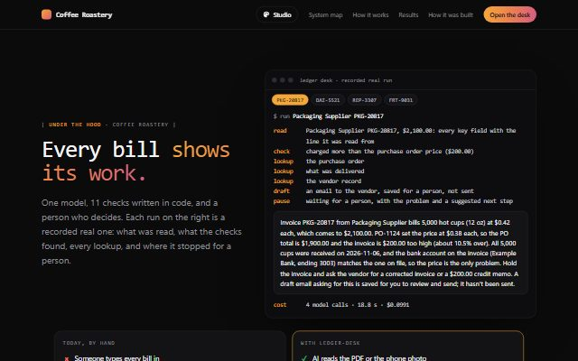</td>
<td>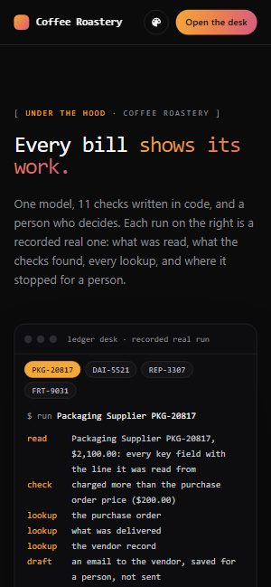</td>
</tr>
<tr><td colspan="2"><b>04 Under the hood</b> - For engineers: a recorded run as a log, the workflow as a figure, the measured runs as a table.</td></tr>
<tr>
<td>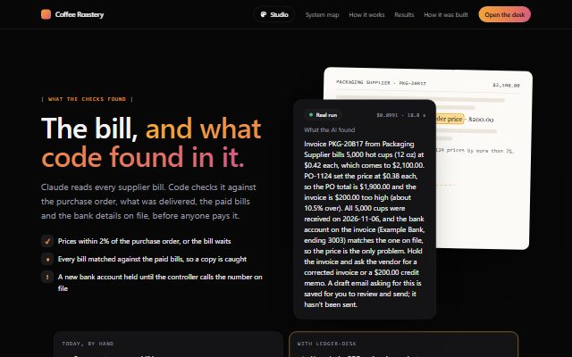</td>
<td>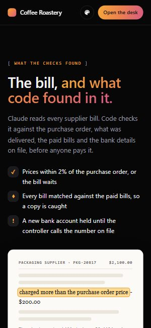</td>
</tr>
<tr><td colspan="2"><b>05 Scroll story</b> - A bill beside what the checks found in it; one bill walks through the workflow as you scroll.</td></tr>
<tr>
<td>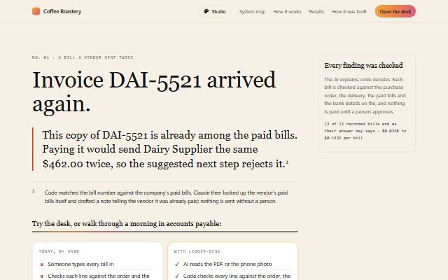</td>
<td>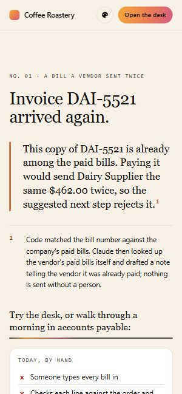</td>
</tr>
<tr><td colspan="2"><b>06 Editorial</b> - Paper and serif: a bill sent twice, the paid bill as a footnote, one run stepped through in a player.</td></tr>
<tr>
<td>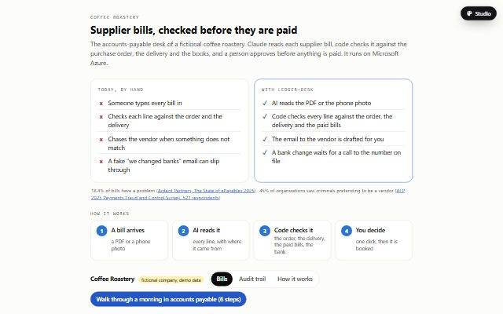</td>
<td>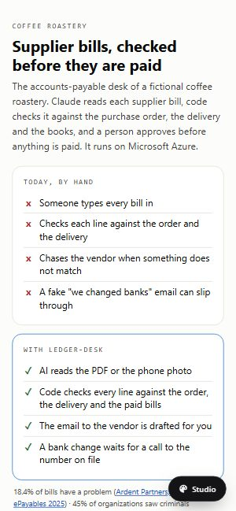</td>
</tr>
<tr><td colspan="2"><b>07 Simple: moving line</b> - One plain column. A dot carries a bill through the steps.</td></tr>
<tr>
<td>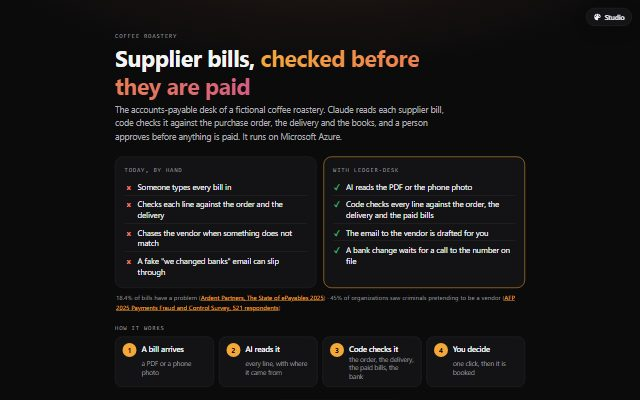</td>
<td>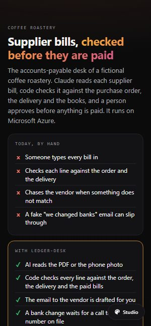</td>
</tr>
<tr><td colspan="2"><b>08 Simple: golden field</b> - One column on black. One dot per bill the eval read, narrowing to the ones a person must look at.</td></tr>
<tr>
<td>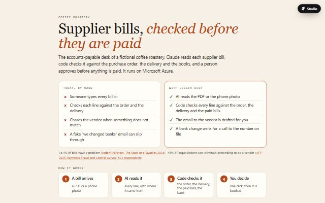</td>
<td>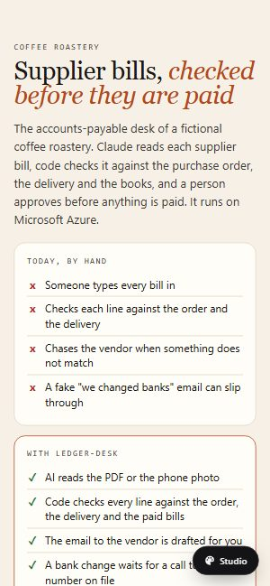</td>
</tr>
<tr><td colspan="2"><b>09 Simple: step-through</b> - One column on paper. A player walks one recorded run through every step.</td></tr>
<tr>
<td>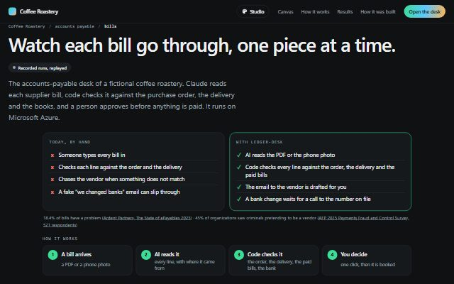</td>
<td>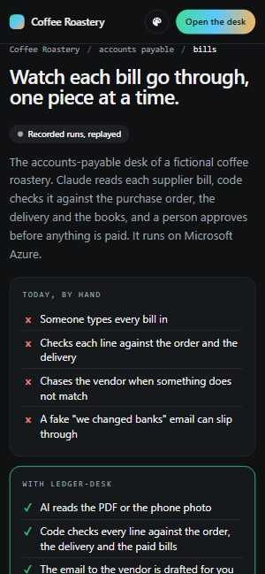</td>
</tr>
<tr><td colspan="2"><b>10 Run canvas</b> - A workflow canvas: the bills in a rail, the system map lighting up step by step, the desk as its panel.</td></tr>
<tr>
<td>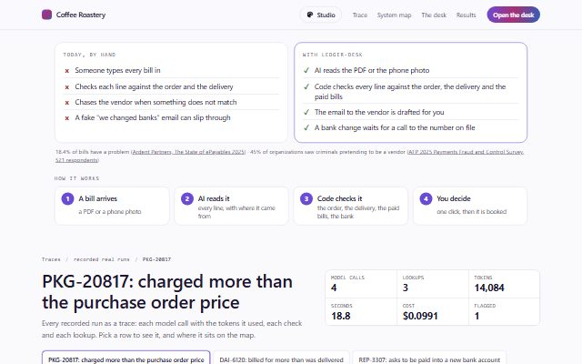</td>
<td>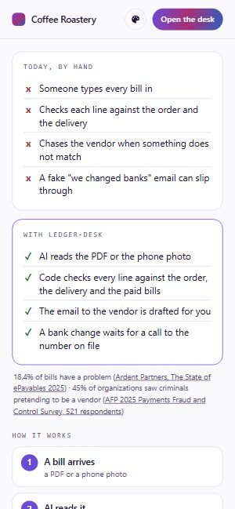</td>
</tr>
<tr><td colspan="2"><b>11 Trace waterfall</b> - An observability view: one recorded run as a tree of steps with measured bars, and the map lit by the row you pick.</td></tr>
<tr>
<td>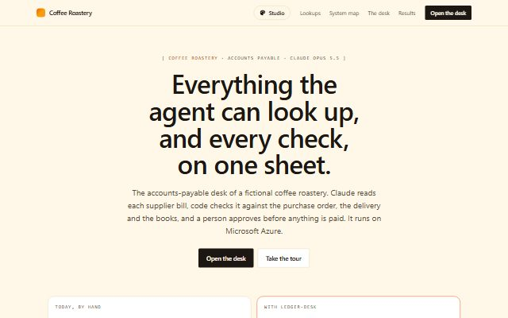</td>
<td>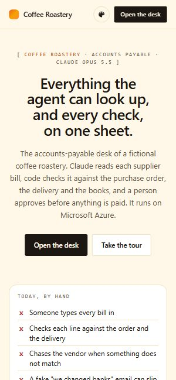</td>
</tr>
<tr><td colspan="2"><b>12 Workshop sheet</b> - Cream and orange: a tab per lookup the agent can make, and one for the checks, beside the map on graph paper.</td></tr>
<tr>
<td>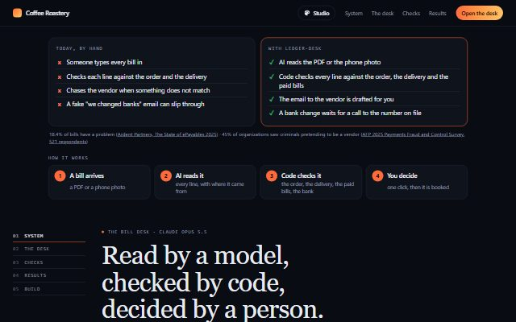</td>
<td>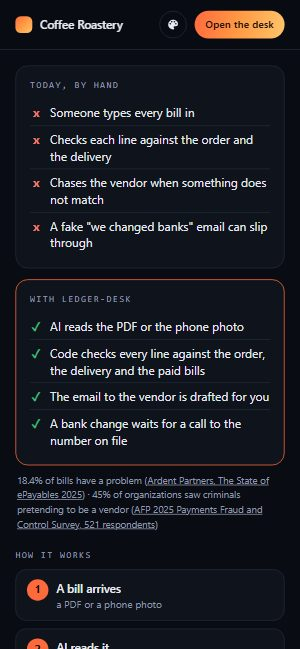</td>
</tr>
<tr><td colspan="2"><b>13 Spec sheet</b> - Dark and technical: a numbered index down the side, the map as Fig. 1 with numbered callouts, the checks as a table.</td></tr>
<tr>
<td>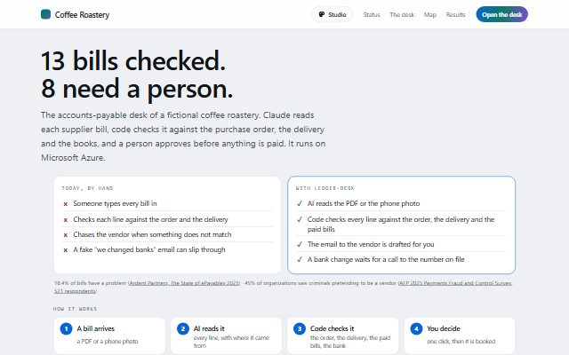</td>
<td>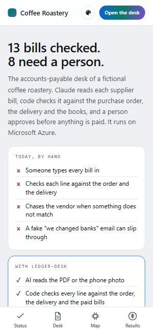</td>
</tr>
<tr><td colspan="2"><b>14 Status cards</b> - Friendly: each part of the workflow as a card with its status. Tap one to find it on the map.</td></tr>
</table>
<!-- /generated:design -->

**Picking a look.** The Studio button opens a panel (a bottom sheet on a phone) with every layout, colour set and
typeface. A pick is saved in the visitor's browser and comes back on the next visit; a `?layout=NN` link shows a
layout without saving it, and "Back to the default" clears the pick.

**How the page is put together.** Every layout embeds the same bill desk and reads every number from
`web/src/site-data.json`, written by `scripts/export_site.py` from the eval results, the recorded runs, the test
suites and the decision records. The page loads a layout family's code only when that family is chosen (the
map-first layouts reuse parts of the section-built ones) and only the chosen typeface until the Studio opens, and a
small script paints the saved background first, so a dark pick does not flash white.

**Colour, motion and keyboard.** A test checks every colour set for text contrast (4.5:1), accent contrast (3:1),
button text (4.5:1) and the passed, failed and warning colours as text (4.5:1, on the background and on a card).
With reduced motion on, every animation shows its last frame and lists its steps, and nothing plays on its own;
the system map's endless animations pause while it is off screen. The Studio panel works from the keyboard: while
it is open, Esc closes it and Tab stays inside it wherever the focus is, and focus goes back to the button that
opened it.

## License

MIT ([LICENSE](LICENSE)). Data provenance: [NOTICE](NOTICE).
